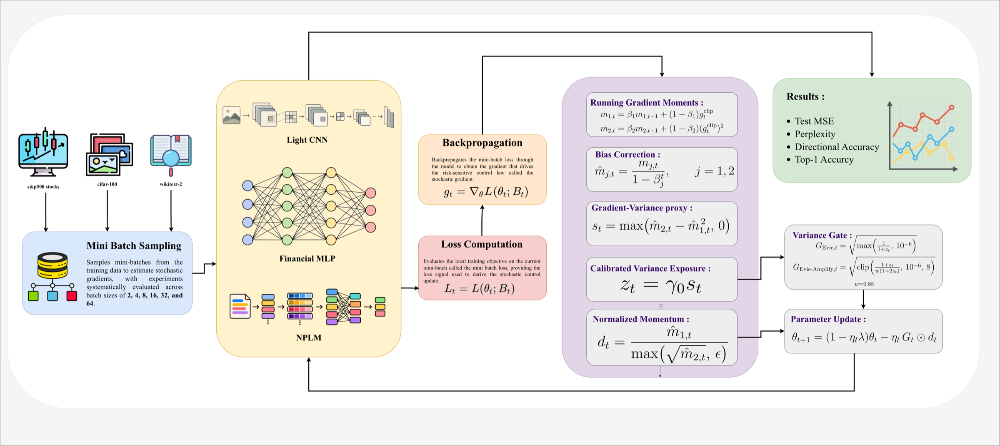

# Evie: Risk-Sensitive Modulation of Adam for Stochastic Optimization

Code for the Evie family of optimizers, which multiply the Adam-style adaptive step by a noise-dependent gate derived from a risk-sensitive (Jacobson-Whittle) control formulation of training. Coordinates with higher gradient-noise variance are shrunk more. **Evie-Amplify** additionally allows bounded amplification on low-variance coordinates.



## Overview

Each step samples a mini-batch, backpropagates the loss, and keeps running gradient moments. The variance proxy `s_t = max(m2_hat - m1_hat^2, 0)` is scaled by a calibrated `gamma0` into an exposure `z_t`, which sets a per-coordinate gate: Evie only shrinks the Adam step, Evie-Amplify additionally allows bounded amplification (capped at 8). The gated, normalized-momentum update is applied with decoupled weight decay. Experiments cover finance (S&P 500 stocks, MLP), vision (CIFAR-100, light CNN) and language (WikiText-2, NPLM) across batch sizes 2 to 64.

## Packages

```bash
pip install evie-optim            # Evie (shrink-only gate)
pip install evie-amplify-optim    # Evie-Amplify (bounded amplification)
```

```python
from evie_optim import EvieOptimizer
optimizer = EvieOptimizer(model.parameters(), lr=1e-3, target_wp=0.85)
# ... training loop ...
if step == 125:                   # calibrate gamma0 once, early in training
    optimizer.calibrate_gamma0()
```

```python
from evie_amplify_optim import EvieAmplifyOptimizer
optimizer = EvieAmplifyOptimizer(model.parameters(), lr=1e-3, well_pos_max=8.0)
```

## Repository Structure

```
evie-optimizer/
├─ assets/architecture.png      # method diagram
├─ requirements.txt
├─ finance/                     # S&P 500 next-day return regression (MLP)
│  ├─ benchmark/                # benchmark_partA..D
│  ├─ batchsize/                # batchsize_{2,4,8,16,64}
│  └─ modelsize/                # modelsize_partA..C
├─ language/                    # next-token prediction, 5k vocab (NPLM)
│  ├─ benchmark/
│  ├─ batchsize/
│  └─ modelsize/
├─ vision/                      # image classification (light CNN)
│  ├─ benchmark/
│  ├─ batchsize/
│  └─ modelsize/
├─ evie_exp/                    # ablation framework (package)
│  ├─ optim/                    # Evie family, gates, AdaBelief, factory
│  ├─ domains/                  # finance / language / vision tasks
│  ├─ protocol/                 # LR search, seeding, budget, resume, stats
│  ├─ analysis/                 # tables, claim matrix, AdaBelief comparison
│  ├─ scripts/                  # run_all, run_cell, tune_cell, pack_results
│  ├─ theory/                   # numerical checks of the theory (r1a..r1g)
│  └─ configs/                  # profiles and the finance ticker list
├─ cpu_checks/                  # synthetic CPU validation and local optimizer references
└─ notebooks/
   ├─ adabelief_all_domains.ipynb   # runs benchmark_partD_adabelief.py in all 3 domains
   └─ ablation_all_domains.ipynb    # runs the evie_exp ablation in all 3 domains
```

## Which Script Is What

Every script is self-contained and runs one slice of the experiments. The file name says which slice.

| Suffix | Optimizers it runs | Used for |
| --- | --- | --- |
| `benchmark_partA.py` | AdamW, Evie | main benchmark |
| `benchmark_partB.py` | AdamW, Evie-Amplify | main benchmark |
| `benchmark_partC.py` | AdamW, Sophia, AdaHessian | main benchmark |
| `benchmark_partD_adabelief.py` | AdaBelief | AdaBelief baseline, same protocol as parts A to C |
| `modelsize_partA/B/C.py` | same split as the benchmark parts | model-size sweep |
| `batchsize_N.py` | AdamW, Evie, Evie-Amplify, Sophia, AdaHessian | batch size N (2, 4, 8, 16, 64) |

The parts are a parallel split of one experiment so that each fits into a single session. Each part includes AdamW, so AdamW is re-run in every part and differs slightly between parts. Install the dependencies with `pip install -r requirements.txt`, then run a script directly, for example `python finance/benchmark/benchmark_partA.py`.

## Running the Notebooks

The notebooks are self-contained: they embed the code they need and run end to end on a Kaggle session (GPU T4 x2, Internet on, *Run All*). Each run stops cleanly after 9 h 55 min, writes a checkpoint, and resumes from it in a new session. The embedded code is the same as the files in `evie_exp/` and the `benchmark_partD_adabelief.py` scripts.

## CPU mathematical checks

The synthetic finite-horizon validation suite is in [`cpu_checks/`](cpu_checks/README.md). It checks exact-loss calculations, optimizer correspondence, calibrated gates, momentum expansions, noncommuting matrices, adaptive-reference behavior, and scalar bounds using CPU arithmetic.

```bash
python -m pip install -r cpu_checks/requirements.txt
PYTHONPATH=cpu_checks python -m unittest discover -s cpu_checks/tests
python cpu_checks/run.py --profile smoke --source-root .
python cpu_checks/run.py --profile core --source-root .
```

The suite reads its reference optimizer modules and the existing benchmark classes without starting training. Generated CPU artifacts stay in a gitignored output folder. See the CPU-check README for resume, verification, output-path options, and the scope of each check.

## Benchmark Results

Setup shared by all rows: 5000 steps, batch size 32, cosine decay to 0.1 x lr, gradient clipping at 5, seeds 42/43/44, per-optimizer learning-rate search over `[1e-4, 3e-4, 1e-3, 3e-3]` (100-step search). Values are mean +/- std as logged by the runs. Lower is better for loss, perplexity, MSE and RMSE; higher is better for accuracy.

AdaBelief (`eps=1e-16`, decoupled weight decay 1e-4, no rectification) was run as a separate run under the same code, data, splits, seeds and protocol as the other optimizers. AdamW was re-run alongside each comparator group and differs slightly between runs; the AdamW row below is from the Evie run.

### Language (5k vocab, 10 shards)

| Optimizer | Val loss | Perplexity | Top-1 acc |
| --- | --- | --- | --- |
| AdamW | 5.085 +/- 0.019 | 161.7 +/- 3.1 | 0.1025 +/- 0.0053 |
| Evie | 5.108 +/- 0.020 | 165.4 +/- 3.3 | 0.0991 +/- 0.0051 |
| Evie-Amplify | 5.079 +/- 0.020 | 160.6 +/- 3.2 | 0.1029 +/- 0.0051 |
| Sophia | 4.909 +/- 0.016 | 135.6 +/- 2.2 | 0.1226 +/- 0.0061 |
| AdaHessian | 6.823 +/- 0.035 | 919.2 +/- 33 | 0.0000 +/- 0.0000 |
| AdaBelief | 5.106 +/- 0.019 | 165.0 +/- 3.2 | 0.1017 +/- 0.0052 |

### Finance (100 tickers)

| Optimizer | Test MSE | Test RMSE | Directional acc |
| --- | --- | --- | --- |
| AdamW | 0.001149 +/- 0.0043 | 0.02497 +/- 0.023 | 0.4926 +/- 0.030 |
| Evie | 0.001557 +/- 0.0077 | 0.02550 +/- 0.030 | 0.4941 +/- 0.029 |
| Evie-Amplify | 0.000993 +/- 0.0042 | 0.02371 +/- 0.021 | 0.4947 +/- 0.029 |
| Sophia | 0.001801 +/- 0.0066 | 0.02948 +/- 0.031 | 0.4944 +/- 0.030 |
| AdaHessian | 0.04018 +/- 0.12 | 0.1142 +/- 0.16 | 0.5128 +/- 0.028 |
| AdaBelief | 0.000698 +/- 0.0018 | 0.02211 +/- 0.014 | 0.4928 +/- 0.029 |

### Vision

| Optimizer | Top-1 (%) | Top-5 (%) | Val loss |
| --- | --- | --- | --- |
| AdamW | 37.89 +/- 0.64 | 66.84 +/- 0.89 | 2.486 +/- 0.058 |
| Evie | 38.08 +/- 0.67 | 67.36 +/- 0.77 | 2.466 +/- 0.046 |
| Evie-Amplify | 37.71 +/- 0.64 | 66.74 +/- 0.85 | 2.510 +/- 0.050 |
| Sophia | 36.07 +/- 1.3 | 64.37 +/- 0.29 | 2.716 +/- 0.015 |
| AdaHessian | 20.80 +/- 0.48 | 45.34 +/- 0.52 | 3.388 +/- 0.0092 |
| AdaBelief | 37.50 +/- 0.31 | 66.41 +/- 0.58 | 2.519 +/- 0.040 |

On these benchmarks AdaBelief is comparable to AdamW and Evie on language and vision, and has the lowest finance MSE and RMSE. Differences between Evie, Evie-Amplify, AdamW and AdaBelief are mostly within one standard deviation; Sophia is clearly best on language and AdaHessian is clearly worst on language and vision. The model-size and batch-size sweeps are produced by the scripts under each domain folder.

## License

MIT
